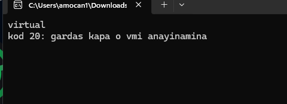

# antivm

small header only c++ library for checking vms and debuggers on windows

checks cpu and firmware data including smbios and acpi
also reports tpm and boot state along with pci devices disks and driver details

## compiling

use a c++17 compiler and add src to your include path
include the [vm header](src/vm.hpp) from your own program
msvc and clang cl builds return unknown for the assembly trap checks
zig windows gnu builds run those checks on x64 and x86

## limits

these checks report observable evidence rather than prove a machine is physical
a hypervisor can change the cpu and firmware data visible to its guest
the hyper-v root partition exception requires the documented Hv#1 interface
before interpreting its partition privileges

## tests

```sh
cmake -S . -B build -DANTIVM_BUILD_TESTS=ON
cmake --build build --config Release
ctest --test-dir build -C Release --output-on-failure
```

## throughput



## license

original contributions use the [mit license](LICENSE)
